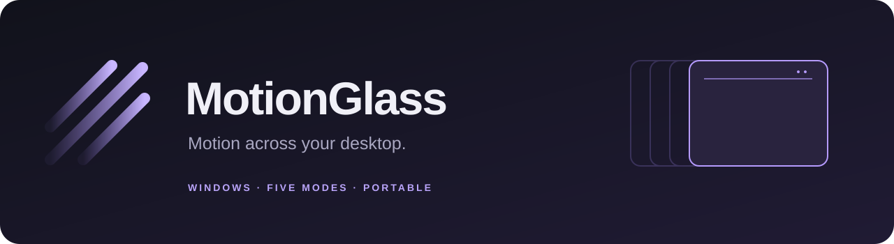

<p align="center">
  
</p>

<p align="center">
  <a href="https://github.com/qemvix/MotionGlass/releases/latest"></a>
  <a href="https://github.com/qemvix/MotionGlass/actions/workflows/windows.yml"></a>
  
  <a href="LICENSE"></a>
</p>

<p align="center">
  Desktop-wide motion blur, with five rendering modes and a simple set of controls.
</p>

<p align="center">
  <a href="https://github.com/qemvix/MotionGlass/releases/latest"><strong>Download for Windows</strong></a>
  &nbsp; · &nbsp; <a href="docs/usage.md">User guide</a>
  &nbsp; · &nbsp; <a href="docs/troubleshooting.md">Troubleshooting</a>
  &nbsp; · &nbsp; <a href="CHANGELOG.md">Changelog</a>
</p>

## What it does

MotionGlass captures the visible desktop, processes successive frames on the GPU, and displays the result through a click-through overlay. Moving windows, desktop animations, and captured cursor images can leave a directional blur or a fading trail, depending on the mode.

- **Five modes:** Velocity based, Frame blending, Hybrid blending, Accumulation max, and Accumulation mix.
- **0–100% amount control** in adjustable modes; 0% turns their effect off.
- **Refresh rate scaling** for Velocity based mode.
- **Global shortcuts and a tray menu** to toggle the effect or turn it off.
- **Portable and local:** no installer, administrator access, account, recording, or screen uploads.
- **Starts off:** the first-run selection is Velocity based at 50%. Saved settings never automatically enable blur.

## Download and run

1. Open the [latest release](https://github.com/qemvix/MotionGlass/releases/latest).
2. Download **MotionGlass-v1.0.0-win-x64.zip** and extract it.
3. Run **MotionGlass.exe**. The Windows runtime is included.
4. Switch **Desktop motion blur** on when you want the effect.

Close the app to stop blur and exit. Minimize it to keep it available in the system tray.

| Shortcut | Action |
| --- | --- |
| **Ctrl + Alt + B** | Toggle desktop blur |
| **Ctrl + Alt + Esc** | Turn blur off |

## Choose a mode

| Mode | Appearance | Amount slider | Refresh rate scaling |
| --- | --- | --- | --- |
| **Velocity based** | Directional blur along motion estimated between frames | Enabled | Enabled |
| **Frame blending** | Weighted blend of the latest four frames | Greyed out; fixed blend | Greyed out |
| **Hybrid blending** | Directional blur combined with the four-frame blend | Greyed out; fixed blend | Greyed out |
| **Accumulation max** | Bright trails from fading, per-channel maximum history | Enabled | Greyed out |
| **Accumulation mix** | Smooth trails from mixing each frame with fading history | Enabled | Greyed out |

Disabled controls keep their previous values for when you return to a mode that uses them. Frame and Hybrid blending use fixed settings; use the power switch or shortcut to turn those modes off.

## Requirements and practical limits

**Windows 10 version 2004/build 19041 or newer, or Windows 11 · x64 · Direct3D 11 · SDR display**

MotionGlass is a desktop overlay. Ordinary desktop windows and borderless applications are its intended use. Secure desktops, protected video, and exclusive fullscreen applications can bypass the effect. HDR displays are paused with an explanatory message.

The effect adds capture latency and GPU load. One 1920×1080 test system reported about **30–33 FPS in Velocity/Hybrid** and **60–65 FPS in the temporal modes**. These are initial observations, not performance guarantees. A high-refresh-rate display does not guarantee that the overlay will render at the display's native rate.

Velocity mode estimates motion from images, so fast movement, repeated patterns, and newly appearing content can produce imperfect blur. The live system cursor stays sharp and responsive, with a captured trail rendered beneath it. Multi-monitor and rotated-display paths are implemented but have not been verified on hardware.

See the [user guide](docs/usage.md) and [troubleshooting notes](docs/troubleshooting.md) for details.

## Build and verify

Install the **.NET 10.0.401 SDK** on Windows; `global.json` pins this version for reproducible builds. From a permitted local copy of the repository:

```powershell
dotnet restore MotionGlass.slnx
dotnet build MotionGlass.slnx -c Release --no-restore
```

Run the offscreen checks without enabling desktop blur:

```powershell
./scripts/Test.ps1
```

Create the portable package:

```powershell
./scripts/Package.ps1
```

The Windows workflow builds the app, runs the same offscreen checks, and uploads a portable package as a workflow artifact. It does not enable desktop capture. See [architecture](docs/architecture.md) and [validation](docs/validation.md).

## License and contact

**Copyright (c) 2026 qemvix. All rights reserved.**

MotionGlass is proprietary. Official releases may be downloaded, installed, and used for personal use under the [license](LICENSE). Copying, cloning, modifying, or redistributing original project code or assets requires prior written permission, except where applicable law or the hosting platform's terms permit otherwise.

Third-party components retain their own licenses; see [third-party notices](THIRD-PARTY-NOTICES.txt). Questions: [electrolighxt@outlook.com](mailto:electrolighxt@outlook.com).
