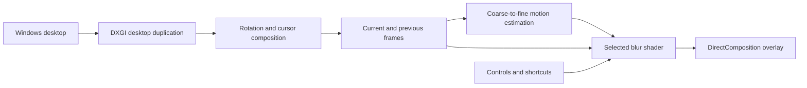

# Architecture

[Back to MotionGlass](../README.md)

MotionGlass is a .NET 10 Windows Forms app using Vortice bindings for Direct3D 11, DXGI, and DirectComposition.

## Display workers

`DesktopEngine` enumerates displays and gives each one a dedicated rendering thread. A worker chooses the adapter that owns its display, creates the duplication session and GPU resources, and presents to a topmost overlay. The UI thread owns the windows; the worker owns its Direct3D context.

Overlay windows use layered, transparent, non-activating styles so input can reach underlying applications. `WDA_EXCLUDEFROMCAPTURE` is applied and checked before the effect is allowed to start, preventing the overlay from recursively capturing its own rendered output.

## Rendering

`GraphicsPipeline` keeps desktop frames, normalized frames, three history frames, accumulation history, and low-resolution flow fields on the GPU. `Shaders.hlsl` contains the normalization, motion search, blur, and copy passes.

Velocity mode searches image patches from coarse to fine, produces a motion field, dilates nearby motion around edges, and integrates 12 samples along the estimated direction. This is image-based motion estimation rather than exact motion vectors supplied by applications.

Frame blending uses a four-frame weighted history. Hybrid combines the weighted history and directional blur. Accumulation modes retain a decaying per-channel maximum or an exponentially weighted mix. Accumulation decay uses elapsed time.

`CursorImage` retrieves the current cursor image and reconstructs transparency using black and white backgrounds, supporting modern color and legacy monochrome cursor shapes. The actual system cursor is not replaced or hidden.

## State and recovery

`Settings` is an immutable snapshot shared with workers. The power state is separate and is never restored as enabled at launch. UI control states follow the selected mode.

Power off and adjustable 0% hide overlays. Capture failures hide the affected overlay and retry after a delay. A presentation watchdog hides stale overlays, and display changes rebuild the workers. HDR displays are paused rather than processed through the SDR pipeline.

## Verification boundary

The default self-test creates a WARP software Direct3D device and synthetic image frames. It does not enumerate or capture the desktop. Visible UI and desktop tests are compiled only when the development-only `MOTIONGLASS_DEVELOPMENT_TESTS` symbol is supplied; release builds and CI do not define it.
